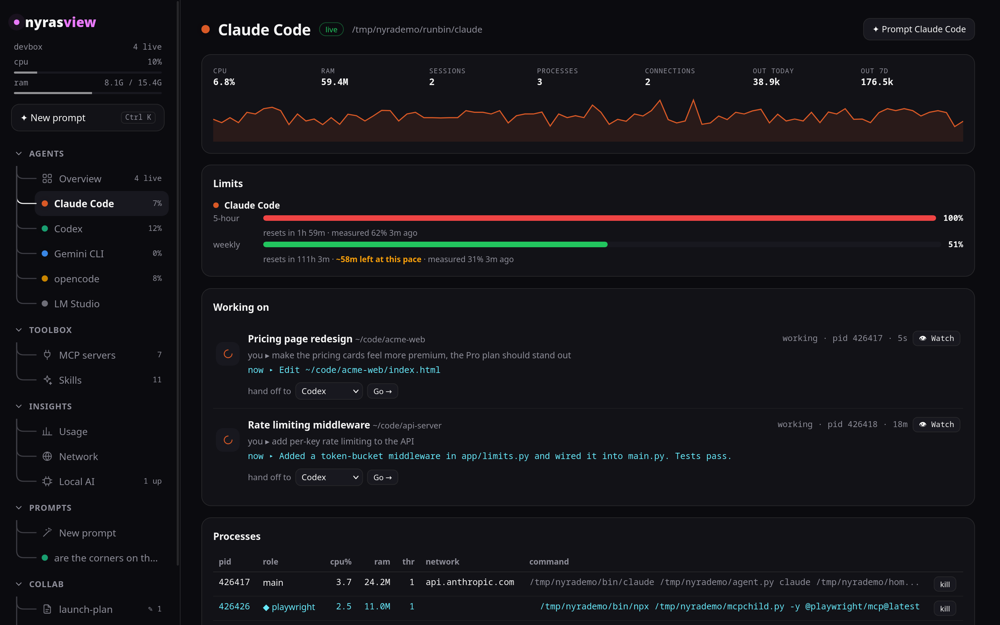

# nyrasview

A monitor and control panel for your AI coding agents, not your whole system.

See how much CPU, RAM and network every vibe-coding tool is using, which MCP servers it has spawned, what skills it can use and how many tokens it has burned. Then hand different sections of the same document to different AIs and watch them write it together.


<sub>[Full-quality MP4](docs/media/demo.mp4) · the demo uses fake agents and data from <code>tools/demo.py</code></sub>

Supports Claude Code, Codex, Gemini CLI, opencode, Kimi CLI, Antigravity, Cursor, Qwen Code, Copilot CLI, Crush, Amp, Factory Droid, Goose, Aider, Windsurf, Ollama, LM Studio and OpenRouter. You can add more in a config file.

## A look around

| | |
|---|---|
|  **Overview:** every agent, session, limit, alert and token at a glance |  **Watch:** the file and the part of the page an agent is editing, with its cursor; hover to leave a note |
|  **Prompt and compare:** ask several agents at once and watch them answer side by side |  **MCP manager:** every server against every agent, one click to add or remove |
|  **Collab:** different AIs writing different sections of one document |  **Usage:** 14 days of tokens per agent and model |
|  **Agent page:** sessions, limits, processes, MCP and network |  **Terminal UI:** the same data in your terminal |

## Install

You need **Python 3.11 or newer**. The only dependencies are `psutil`, plus `windows-curses` on Windows, and they're installed automatically. These steps use [pipx](https://pipx.pypa.io), which puts `nyrasview` on your PATH in its own environment.

### Windows

In PowerShell:

```powershell
winget install Python.Python.3.13
py -m pip install --user pipx
py -m pipx ensurepath
```

Close and reopen the terminal, then:

```powershell
pipx install https://github.com/nyrasdev/nyrasview/archive/refs/heads/main.zip
nyrasview gui
```

Windows Terminal is recommended for the TUI (`nyrasview`).

### macOS

```sh
brew install pipx
pipx ensurepath
pipx install https://github.com/nyrasdev/nyrasview/archive/refs/heads/main.zip
nyrasview gui
```

### Linux

```sh
sudo pacman -S python-pipx      # Arch / CachyOS
sudo apt install pipx           # Debian / Ubuntu
sudo dnf install pipx           # Fedora
pipx ensurepath
pipx install https://github.com/nyrasdev/nyrasview/archive/refs/heads/main.zip
nyrasview gui
```

**With uv instead of pipx** (any OS): `uv tool install https://github.com/nyrasdev/nyrasview/archive/refs/heads/main.zip`

**Update:** run the same `pipx install` (or `uv tool install`) command again with `--force`.

**From a clone:** `git clone https://github.com/nyrasdev/nyrasview && cd nyrasview && python -m nyrasview`

### Where things live

| | Linux | Windows | macOS |
|---|---|---|---|
| config | `~/.config/nyrasview/config.toml` | `%APPDATA%\nyrasview\config.toml` | `~/.config/nyrasview/config.toml` |
| state (runs, alerts, backups) | `~/.local/state/nyrasview` | `%LOCALAPPDATA%\nyrasview` | `~/Library/Application Support/nyrasview` |
| desktop alerts | `notify-send` | Windows toast notifications | Notification Center |
| handoff opens | kitty, ghostty, wezterm, foot, alacritty, konsole, gnome-terminal or xterm | Windows Terminal, or a new console | Terminal or iTerm |
| `nyrasview service install` | systemd user service | Task Scheduler (runs at logon) | launchd agent |
| clipboard for notes | `wl-copy`, `xclip` or `xsel` | built in | built in |

[](https://github.com/nyrasdev/nyrasview/actions/workflows/ci.yml)

Every push is tested on Linux, Windows and macOS with Python 3.11 and 3.13.

## Use

| command | what it does |
|---|---|
| `nyrasview` | terminal dashboard with tabs: agents, MCP, skills, usage, network, collab |
| `nyrasview gui` | the same dashboard in your browser (localhost only) |
| `nyrasview status` / `ps` / `mcp` / `skills` / `usage` | one-shot CLI views, most of which take `--json` |
| `nyrasview agents` | every known agent and how collab calls it |
| `nyrasview ask <agent> "…"` | prompt one agent, or `claude,codex` to compare, and stream the answer |
| `nyrasview runs` | prompts started from nyrasview |
| `nyrasview limits` | usage limit gauges and time left at your pace |
| `nyrasview inbox` | recent alerts (`notify-test` sends one) |
| `nyrasview mcp add/copy/rm/test` | manage MCP servers for every agent at once |
| `nyrasview daemon` / `service install` | alerts and relay without a UI, optionally on login |
| `nyrasview now` | what every running agent is working on right now |
| `nyrasview local` | local AI servers and their models; `local ask ollama "hi"` to try one |
| `nyrasview handoff` | hand the current task to another agent (`--to codex`, `-w` new window, `-n` dry run) |
| `nyrasview relay` | watch for usage limits and hand off automatically (or add `--relay` to `nyrasview`/`gui`) |
| `nyrasview say "…"` | send a live note to the agent working in this folder |
| `nyrasview hooks install` | let live notes reach Claude Code mid-task |
| `nyrasview obsidian` | your Obsidian vaults |

### What it tracks per agent

- **Processes:** the whole process tree, labelled main / MCP / shell / child, with per-process kill
- **Resources:** CPU, RAM and threads, plus a CPU history sparkline
- **Network:** live connections classified by provider (anthropic, openai, google, openrouter, moonshot…) and listening ports
- **MCP:** configured servers from every agent's config, matched to the processes actually running
- **Skills:** skills, slash commands, subagents, rules, workflows, extensions and memory files
- **Usage:** tokens today / 7 days / all time per model, read from each tool's local logs, plus OpenRouter credit usage via `OPENROUTER_API_KEY`
- **Working on:** for each Claude Code, Codex, Gemini or Qwen session: the project, the session title, your last prompt and the tool it is running right now

## Prompt from inside nyrasview

Press **Ctrl+K** in the GUI (or click ✦ New prompt). Write the prompt, pick one or more agents, a folder and a mode:

| mode | what the agent may do |
|---|---|
| **Ask** | read and look around, no changes |
| **Edit** | create and change files in the folder |
| **Auto** | everything, including commands, without asking |

- **Transcript:** answers stream in live, with tool calls shown as chips (click one to see its output). Each run ends with time, tokens and cost.
- **Follow up:** continues the same conversation; Claude Code resumes its real session.
- **Compare:** pick several agents and they answer the same prompt side by side.
- **Terminal:** opens the agent interactively with your prompt. **Send to running session** delivers it into an agent that is already working in that folder.
- From the terminal: `nyrasview ask claude "why is the build slow?" -d ~/app`, `nyrasview ask claude,codex "…"` to compare, `-c <run>` to follow up, `nyrasview runs` for history. In the TUI, press `p` on an agent.

## Watch: see exactly what an agent is touching

Click **👁 Watch** on any Claude Code or Codex session (or a row in the overview's *Right now* list):

- **Code:** the file it last edited, with the changed lines highlighted in the agent's color and its cursor on them. Click any older edit in the timeline to jump back.
- **Website:** if the project runs a dev server (Vite, Next, plain `http.server`…), a live preview appears. nyrasview works out which element the edit touched from its classes, ids, CSS selectors or text, and draws a box and the agent's cursor on it. Hot reload keeps working.
- **Talk to it:** hover the box (or Alt+click anything on the page, or click a line number in the code) and type something like *"soften the corners a bit more"*. The note carries the file, lines and element, and goes to the agent:
  - **Claude Code** gets it after its next tool call, through a hook. Turn it on once with `nyrasview hooks install`; a backup of `~/.claude/settings.json` is saved first.
  - **Other agents** get it copied to your clipboard, ready to paste.
- From the terminal: `nyrasview say "make the header sticky" -f src/Header.tsx`

## Alerts: know when you're needed

nyrasview tells you when:

- an agent **needs your permission** or is waiting for you
- it **finished**
- a prompt run or collab task **is done or failed**
- an agent **hit its limit** or is **about to**

Alerts arrive as desktop notifications, browser notifications (🔔 in the GUI), or on your phone through [ntfy](https://ntfy.sh). They all collect in the GUI inbox and in `nyrasview inbox`.

- With `nyrasview hooks install`, Claude Code reports permission prompts and finishes the moment they happen. Without the hook, nyrasview works it out from the session logs.
- To keep alerts running without the GUI open: `nyrasview service install --relay`. This sets up a systemd user service on Linux, a Task Scheduler logon task on Windows, or a launchd agent on macOS.

```toml
[notify]
desktop = true
ntfy = "my-secret-topic"   # phone alerts via the ntfy app
soon_pct = 90              # warn at 90% of a limit
```

## Limits: see the wall before you hit it

`nyrasview limits` (and the Limits panel in the GUI) shows the 5-hour and weekly windows for Claude Code and Codex:

- how full each window is
- when it resets
- how long you have left at your current pace

**Where the numbers come from:**

- **Claude:** nyrasview takes the real reading from any run it starts (or one tiny *Calibrate* call) and extrapolates it with the token burn rate from your local logs.
- **Codex:** read straight from its own logs.

With relay on, the handoff file is written as soon as a limit gets close, so the switch is instant.

## MCP manager

The MCP page shows every server against every agent in one grid. Click a cell to switch a server on or off for that agent.

- **Add:** paste a command, a URL or a JSON snippet, or pick a preset (playwright, context7, fetch, memory…).
- **Test:** starts the server and lists its tools before you commit to it.
- **Add to all:** copies a server, env vars included, into every agent's own format.
- **Formats written:** Claude (`claude mcp`), Codex TOML, opencode, Gemini, Qwen, Cursor, Kimi, Antigravity, Windsurf, Copilot, Droid, Crush, Amp.
- **Backups:** every file is backed up before it changes.

```sh
nyrasview mcp add "npx -y @playwright/mcp@latest" --to all
nyrasview mcp copy context7 --from claude --to codex,gemini
nyrasview mcp test "uvx mcp-server-fetch"
nyrasview mcp rm playwright
```

## Relay: when one agent runs out, the next one takes over

When Claude Code or Codex hits its usage limit, nyrasview writes `.nyrasview/HANDOFF.md` into the project with:

- your prompts (the latest one marked)
- what the agent said it did
- every file it changed and the commands it ran
- `git status` and the diff vs HEAD

Then it opens the next installed agent in a new terminal and tells it to read that file and carry on. The default order is codex, claude, gemini, opencode, cursor and so on; set `[handoff] chain = [...]` to change it. `.nyrasview/` is added to `.git/info/exclude` so it is never committed.

```sh
nyrasview relay                 # automatic
nyrasview handoff --to gemini   # manual, right here in this terminal
```

## Local AI

Ollama, LM Studio, llama.cpp, vLLM, Jan and KoboldCpp are detected on their default ports. Any other OpenAI-compatible server can be added:

```toml
[[local]]
name = "Box"
url = "http://192.168.1.20:8000"
model = "qwen3-32b"
```

Local models can be assigned collab sections like any other agent (`collab assign doc.md Intro ollama "..."`), and you can try them from the GUI's Local AI page.

## Collab: several AIs, one document

```sh
nyrasview collab new plan.md -t "Launch plan" -s "Goals,Architecture,Risks"
nyrasview collab assign plan.md Goals claude "Three measurable goals"
nyrasview collab assign plan.md Architecture codex "Components and data flow"
nyrasview collab assign plan.md Risks openrouter "Top risks with mitigations" --model moonshotai/kimi-k2
nyrasview collab whole plan.md gemini "Unify tone and remove repetition"
nyrasview collab run plan.md
nyrasview collab undo plan.md
```

Section tasks run in parallel, and each agent sees the whole document for context. Whole-document tasks run after them, one at a time. Every write is backed up, so `undo` steps back one write at a time.

### Obsidian

Notes in a vault work as collab docs, and you can write them as `Vault:Folder/Note`. You can also assign work from inside Obsidian:

```markdown
## Architecture
> [!ai] codex
> Describe the services and how they talk to each other
```

Then run `nyrasview collab watch`. It picks up the callouts in every vault, runs them, writes the answers into those sections and records `ai-authors` in the note's frontmatter.

## Config

`~/.config/nyrasview/config.toml` (on Windows: `%APPDATA%\nyrasview\config.toml`)

```toml
[openrouter]
api_key = "sk-or-..."
model = "anthropic/claude-sonnet-4.5"

[ollama]
model = "qwen3:14b"

[handoff]
chain = ["codex", "gemini", "opencode"]
terminal = "kitty"

[collab]
timeout = 900

[agents.kimi]
headless = { cmd = ["kimi", "--print", "-c", "{prompt}"] }

[agents.myagent]
name = "My Agent"
hex = "#ff8800"
names = ["myagent"]
headless = { cmd = ["myagent", "--prompt-stdin"], stdin = true }
```
